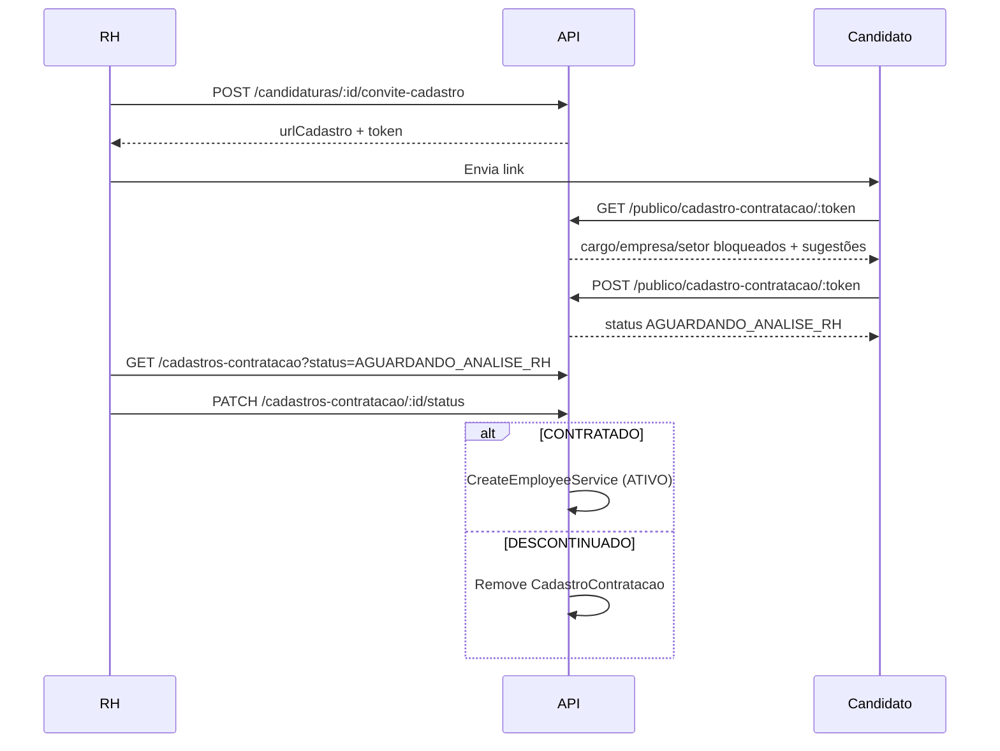

# Documentação do Módulo de Recrutamento

Este documento descreve o cadastro de **anúncios de vaga**, **inscrição pública de candidatos**, **gestão de candidaturas** e o fluxo de **cadastro de contratação** (link enviado ao candidato aprovado, análise manual do RH e efetivação como funcionário ativo).

## 1. Visão Geral

Usuários **ADMIN** ou **ADMINISTRATIVO** podem:

- Criar anúncios com modelo padrão e vínculos obrigatórios: **cargo** (`roleId`), **empresa** (`companyId`) e **setor** (`setorId`).
- Ativar/inativar/encerrar anúncios e analisar candidaturas.
- Gerar **link de cadastro** para candidato selecionado; o cargo, empresa e setor vêm do anúncio e **não podem ser alterados** pelo candidato.
- Listar cadastros enviados (`AGUARDANDO_ANALISE_RH`), aprovar (`CONTRATADO` → cria `Employee` com status `ATIVO`) ou descontinuar (`DESCONTINUADO` → registro descartado).

Candidatos externos (sem login):

- Inscrevem-se em vagas ativas com currículo.
- Acessam o link de cadastro e preenchem os dados de funcionário (obrigatórios + opcionais).

Dependências: **Express**, **Prisma**, **Multer**, **JWT**, **RBAC** e reutilização do `CreateEmployeeService` na aprovação.

## 2. Modelo de Dados

```prisma
enum StatusCadastroContratacao {
    AGUARDANDO_PREENCHIMENTO
    AGUARDANDO_ANALISE_RH
    CONTRATADO
    DESCONTINUADO
}

model AnuncioVaga {
    // ... campos do modelo padrão ...
    roleId    String
    companyId String
    setorId   String
    role      Role
    company   Company
    setor     Setor
}

model Candidatura {
    // ... dados da inscrição ...
    cadastroContratacao CadastroContratacao?
}

model CadastroContratacao {
    id            String @id
    candidaturaId String @unique
    tokenAcesso   String @unique
    roleId        String  // bloqueado
    companyId     String  // bloqueado
    setorId       String  // bloqueado
    status        StatusCadastroContratacao
    // espelha campos de Employee (preenchidos pelo candidato)
    name, cpf, email, telefone, birthDate, admissionDate, ...
    employeeId         String? @unique
    analisadoPorUserId String?
    enviadoEm          DateTime?
}
```

## 3. Fluxo de Contratação



## 4. Regras de Negócio

| Serviço | Responsabilidade |
|---------|------------------|
| **GerarConviteCadastroContratacaoService** | Cria convite com token único; exige anúncio com cargo/empresa/setor. |
| **GetCadastroContratacaoPublicoService** | Formulário público; cargo/empresa/setor somente leitura. |
| **SubmeterCadastroContratacaoService** | Valida campos obrigatórios de funcionário; bloqueia alteração de vínculos. |
| **ListCadastrosContratacaoService** | Lista para análise do RH (`?status=`). |
| **AtualizarStatusCadastroContratacaoService** | `CONTRATADO` cria funcionário; `DESCONTINUADO` apaga cadastro. |

### Campos obrigatórios no cadastro do candidato

`name`, `cpf`, `email`, `telefone`, `birthDate` (mesmas validações do módulo `employees`).

### Opcionais permitidos ao candidato (dados pessoais)

`nacionalidade`, `estadoCivil`, `racaCor`, `filiacao`, `grauInstrucao`, `numeroCtps`, `serieCtps`, `numeroDependentes`, `pis`, `chavePix`, endereço (`cep`, `logradouro`, etc.).

### Campos bloqueados para o candidato

- Vínculos: `roleId`, `companyId`, `setorId` (definidos no anúncio).
- RH na aprovação: `admissionDate`, `valeTransporte`, `valeAlimentacao`, `planoSaude`.

## 5. Endpoints

Base: `/api/v1/recruitment`

### Vagas e candidaturas

| Método | Endpoint | Permissão | Descrição |
|--------|----------|-----------|-----------|
| GET | `/publico/vagas/:id` | Público | Anúncio ativo |
| POST | `/publico/vagas/:id/candidaturas` | Público | Inscrição + currículo |
| POST | `/vagas` | ADMIN, ADMINISTRATIVO | Criar anúncio (inclui `roleId`, `companyId`, `setorId`) |
| GET | `/vagas` | ADMIN, ADMINISTRATIVO | Listar anúncios |
| GET | `/vagas/:id/candidaturas` | ADMIN, ADMINISTRATIVO | Candidaturas com filtro de data |

### Cadastro de contratação

| Método | Endpoint | Permissão | Descrição |
|--------|----------|-----------|-----------|
| POST | `/candidaturas/:id/convite-cadastro` | ADMIN, ADMINISTRATIVO | Gera link para o candidato |
| GET | `/publico/cadastro-contratacao/:token` | Público | Formulário (cargo bloqueado) |
| POST | `/publico/cadastro-contratacao/:token` | Público | Candidato envia dados |
| GET | `/cadastros-contratacao` | ADMIN, ADMINISTRATIVO | Fila de análise (`?status=AGUARDANDO_ANALISE_RH`) |
| GET | `/cadastros-contratacao/:id` | ADMIN, ADMINISTRATIVO | Detalhe do cadastro |
| PATCH | `/cadastros-contratacao/:id/status` | ADMIN, ADMINISTRATIVO | `CONTRATADO` ou `DESCONTINUADO` |

## 6. Exemplos

### Criar anúncio (com cargo, empresa e setor)

```json
{
  "tituloVaga": "Analista de RH",
  "apresentacaoEmpresa": "...",
  "sobreVaga": "...",
  "responsabilidades": "...",
  "requisitos": "...",
  "beneficios": "...",
  "localTrabalho": "São Paulo - SP",
  "tipoContratacao": "CLT",
  "jornadaTrabalho": "44h semanais",
  "roleId": "<uuid-cargo>",
  "companyId": "<uuid-empresa>",
  "setorId": "<uuid-setor>"
}
```

### Gerar link para candidato aprovado

```http
POST /api/v1/recruitment/candidaturas/<candidaturaId>/convite-cadastro
Authorization: Bearer <token>
```

Resposta inclui `urlCadastro` (ex.: `/api/v1/recruitment/publico/cadastro-contratacao/<token>`).

### Candidato preenche e envia

```http
POST /api/v1/recruitment/publico/cadastro-contratacao/<token>
Content-Type: application/json
```

```json
{
  "name": "Maria Silva",
  "cpf": "529.982.247-25",
  "email": "maria@empresa.com",
  "telefone": "(11) 91234-5678",
  "birthDate": "1990-05-10",
  "cep": "01310-100",
  "estadoCivil": "SOLTEIRO"
}
```

### RH aprova ou descontinua

```http
PATCH /api/v1/recruitment/cadastros-contratacao/<id>/status
Authorization: Bearer <token>
Content-Type: application/json

{
  "status": "CONTRATADO",
  "admissionDate": "2026-06-01",
  "valeTransporte": true,
  "valeAlimentacao": true,
  "planoSaude": false
}
```

ou `{ "status": "DESCONTINUADO" }` — remove o cadastro pendente.

## 7. Testes Automatizados (Jest)

96 testes no módulo `recruitment`, incluindo `GerarConviteCadastroContratacaoService`, `SubmeterCadastroContratacaoService`, `AtualizarStatusCadastroContratacaoService` e demais camadas.
