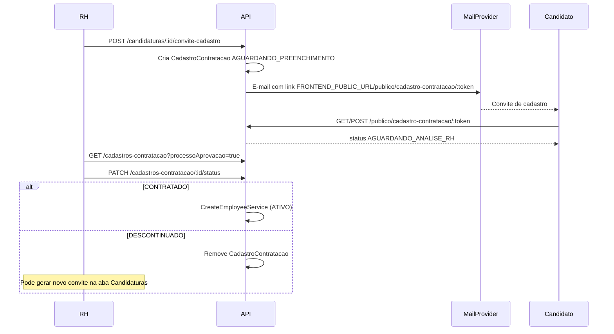

# Documentação do Módulo de Recrutamento

Este documento descreve o cadastro de **anúncios de vaga**, **inscrição pública de candidatos**, **gestão de candidaturas** e o fluxo de **cadastro de contratação** (link enviado ao candidato aprovado, análise manual do RH e efetivação como funcionário ativo).

## 1. Visão Geral

Usuários **ADMIN** ou **ADMINISTRATIVO** podem:

- Criar anúncios com modelo padrão e vínculos obrigatórios: **cargo** (`roleId`), **empresa** (`companyId`) e **setor** (`setorId`).
- Ativar/inativar/encerrar anúncios e analisar candidaturas.
- Enviar **e-mail de convite de cadastro** ao candidato em próxima fase (Nodemailer/Gmail); acompanhar na aba **Processo de aprovação**.
- Validar dados retornados: aprovar (`CONTRATADO` → cria `Employee` com status `ATIVO`) ou negar (`DESCONTINUADO` → permite novo convite).

Candidatos externos (sem login):

- Inscrevem-se em vagas ativas com currículo.
- Acessam o link de cadastro e preenchem os dados de funcionário (obrigatórios + opcionais).

Usuários autenticados (qualquer perfil):

- Visualizam vagas ativas em `/vagas`.
- Candidatam-se via `POST /vagas/:id/candidaturas` (vínculo `userId`, status inicial `PENDENTE`).

Dependências: **Express**, **Prisma**, **Multer**, **JWT**, **RBAC** e reutilização do `CreateEmployeeService` na aprovação.

## 2. Modelo de Dados

```prisma
enum ModoTrabalhoVaga {
    PRESENCIAL
    REMOTO
    HIBRIDO
}

enum StatusCandidatura {
    PENDENTE
    PROXIMA_FASE
    DESCARTADO
}

enum StatusCadastroContratacao {
    AGUARDANDO_PREENCHIMENTO
    AGUARDANDO_ANALISE_RH
    CONTRATADO
    DESCONTINUADO
}

model AnuncioVaga {
    // ... campos do modelo padrão ...
    roleId    String
    companyId String
    setorId   String
    role      Role
    company   Company
    setor     Setor
}

model Candidatura {
    // ... dados da inscrição ...
    userId String?
    status StatusCandidatura @default(PENDENTE)
    descartadoEm DateTime?
    cadastroContratacao CadastroContratacao?
    @@unique([anuncioVagaId, userId])
}

model CadastroContratacao {
    id            String @id
    candidaturaId String @unique
    tokenAcesso   String @unique
    roleId        String  // bloqueado
    companyId     String  // bloqueado
    setorId       String  // bloqueado
    status        StatusCadastroContratacao
    // espelha campos de Employee (preenchidos pelo candidato)
    name, cpf, email, telefone, birthDate, admissionDate, ...
    employeeId         String? @unique
    analisadoPorUserId String?
    enviadoEm          DateTime?
}
```

## 3. Fluxo de Contratação



Variáveis de ambiente: `GMAIL_USER`, `GMAIL_PASS`, `FRONTEND_PUBLIC_URL` (obrigatórias em produção).

## 4. Regras de Negócio

| Serviço | Responsabilidade |
|---------|------------------|
| **GerarConviteCadastroContratacaoService** | Exige `PROXIMA_FASE`; cria token; envia e-mail; rollback se o envio falhar. |
| **EnviarEmailConviteCadastroService** | Monta HTML/texto e envia via `MailProvider` (Nodemailer/Gmail). |
| **ReenviarEmailConviteCadastroService** | Reenvia o mesmo link enquanto `AGUARDANDO_PREENCHIMENTO`. |
| **GetCadastroContratacaoPublicoService** | Formulário público; cargo/empresa/setor somente leitura. |
| **SubmeterCadastroContratacaoService** | Valida todos os campos visíveis obrigatórios; bloqueia vínculos. |
| **ListCadastrosContratacaoService** | Lista cadastros (`?status=` ou `?processoAprovacao=true`). |
| **AtualizarStatusCadastroContratacaoService** | `CONTRATADO` cria funcionário; `DESCONTINUADO` apaga cadastro. |
| **AtualizarStatusCandidaturaService** | Admin altera candidatura para `PROXIMA_FASE` ou `DESCARTADO`. |
| **ListCandidaturasService** / **ListTodasCandidaturasService** | Listagens excluem candidaturas com cadastro de contratação ativo (vão para Processo de aprovação). |
| **LimparCandidaturasDescartadasService** | Remove permanentemente candidaturas `DESCARTADO` com mais de 60 dias. |
| **CreateCandidaturaAutenticadaService** | Candidatura de usuário logado; bloqueia duplicidade por `userId`. |
| **ListAnunciosVagaAtivosService** | Lista vagas `ATIVA` para portal autenticado. |
| **GetAnuncioVagaAtivoService** | Detalhe de vaga ativa com flag `jaCandidatou`. |

### Ciclo de vida da candidatura

1. Criação com status `PENDENTE` (pública ou autenticada).
2. Admin pode alterar para `PROXIMA_FASE` ou `DESCARTADO`.
3. Em `PROXIMA_FASE`, o RH envia convite por e-mail; a candidatura passa ao **Processo de aprovação**.
4. Candidaturas `DESCARTADO` ficam na lixeira e são removidas após 60 dias (job diário no `server.js`).

### Campos obrigatórios no cadastro do candidato

Todos os campos visíveis no formulário público: `name`, `cpf`, `email`, `telefone`, `birthDate`, dados pessoais (`nacionalidade`, `estadoCivil`, `racaCor`, `filiacao`, `grauInstrucao`, `numeroCtps`, `serieCtps`, `numeroDependentes`, `pis`, `chavePix`) e endereço (`cep`, `logradouro`, `numeroEndereco`, `bairro`, `cidade`, `estado`). **Opcional:** `complemento`.

### Campos bloqueados para o candidato

- Vínculos: `roleId`, `companyId`, `setorId` (definidos no anúncio).
- RH na aprovação: `admissionDate`, `valeTransporte`, `valeAlimentacao`, `planoSaude`.

## 5. Endpoints

Base: `/api/v1/recruitment`

### Vagas e candidaturas

| Método | Endpoint | Permissão | Descrição |
|--------|----------|-----------|-----------|
| GET | `/publico/vagas` | Público | Lista anúncios ativos (portal público) |
| GET | `/publico/vagas/:id` | Público | Anúncio ativo |
| POST | `/publico/vagas/:id/candidaturas` | Público | Inscrição pública: `nomeCompleto`, `email`, `pretensaoSalarial`, `mensagemCandidato` obrigatórios; currículo opcional; bloqueia e-mail duplicado na mesma vaga (409) |
| GET | `/vagas/ativas` | Autenticado | Lista vagas ativas |
| GET | `/vagas/ativas/:id` | Autenticado | Detalhe de vaga ativa (`jaCandidatou`) |
| POST | `/vagas/:id/candidaturas` | Autenticado | Candidatura autenticada (currículo opcional) |
| POST | `/vagas` | ADMIN, ADMINISTRATIVO | Criar anúncio (inclui `roleId`, `companyId`, `setorId`) |
| GET | `/vagas` | ADMIN, ADMINISTRATIVO | Listar anúncios |
| GET | `/candidaturas` | ADMIN, ADMINISTRATIVO | Todas as candidaturas (`?anuncioVagaId=`, `?status=`, `?incluirDescartadas=`) — exclui quem tem cadastro ativo |
| GET | `/vagas/:id/candidaturas` | ADMIN, ADMINISTRATIVO | Candidaturas (`?status=`, `?incluirDescartadas=`) |
| PATCH | `/candidaturas/:id/status` | ADMIN, ADMINISTRATIVO | `PROXIMA_FASE` ou `DESCARTADO` |

### Cadastro de contratação

| Método | Endpoint | Permissão | Descrição |
|--------|----------|-----------|-----------|
| POST | `/candidaturas/:id/convite-cadastro` | ADMIN, ADMINISTRATIVO | Gera token, envia e-mail e move para processo de aprovação |
| POST | `/cadastros-contratacao/:id/reenviar-email` | ADMIN, ADMINISTRATIVO | Reenvia e-mail (status `AGUARDANDO_PREENCHIMENTO`) |
| GET | `/publico/cadastro-contratacao/:token` | Público | Formulário (cargo bloqueado) |
| POST | `/publico/cadastro-contratacao/:token` | Público | Candidato envia dados |
| GET | `/cadastros-contratacao` | ADMIN, ADMINISTRATIVO | Lista (`?status=` ou `?processoAprovacao=true`) |
| GET | `/cadastros-contratacao/:id` | ADMIN, ADMINISTRATIVO | Detalhe do cadastro |
| PATCH | `/cadastros-contratacao/:id/status` | ADMIN, ADMINISTRATIVO | `CONTRATADO` ou `DESCONTINUADO` |

Frontend: portal público em `/publico/vagas` e `/publico/vagas/:id`; página de cadastro `/publico/cadastro-contratacao/:token`; validação RH em `/admin/recrutamento/cadastros/:id/validar`.

## 6. Exemplos

### Criar anúncio (com cargo, empresa e setor)

```json
{
  "tituloVaga": "Analista de RH",
  "apresentacaoEmpresa": "...",
  "sobreVaga": "...",
  "responsabilidades": "...",
  "requisitos": "...",
  "beneficios": "...",
  "localTrabalho": "São Paulo - SP",
  "tipoContratacao": "CLT",
  "jornadaTrabalho": "44h semanais",
  "roleId": "<uuid-cargo>",
  "companyId": "<uuid-empresa>",
  "setorId": "<uuid-setor>"
}
```

### Gerar convite e enviar e-mail

```http
POST /api/v1/recruitment/candidaturas/<candidaturaId>/convite-cadastro
Authorization: Bearer <token>
```

Resposta inclui `urlCadastro` (ex.: `/publico/cadastro-contratacao/<token>`), `urlCadastroAbsoluta` e `emailEnviadoPara`. O e-mail é enviado automaticamente via Nodemailer/Gmail.

### Candidato preenche e envia

```http
POST /api/v1/recruitment/publico/cadastro-contratacao/<token>
Content-Type: application/json
```

```json
{
  "name": "Maria Silva",
  "cpf": "529.982.247-25",
  "email": "maria@empresa.com",
  "telefone": "(11) 91234-5678",
  "birthDate": "1990-05-10",
  "nacionalidade": "Brasileira",
  "estadoCivil": "SOLTEIRO",
  "racaCor": "PARDA",
  "filiacao": "João e Ana",
  "grauInstrucao": "SUPERIOR_COMPLETO",
  "numeroCtps": "12345",
  "serieCtps": "001",
  "numeroDependentes": 0,
  "pis": "12345678901",
  "chavePix": "maria@empresa.com",
  "cep": "01310-100",
  "logradouro": "Av. Paulista",
  "numeroEndereco": "1000",
  "bairro": "Bela Vista",
  "cidade": "São Paulo",
  "estado": "SP"
}
```

### RH aprova ou descontinua

```http
PATCH /api/v1/recruitment/cadastros-contratacao/<id>/status
Authorization: Bearer <token>
Content-Type: application/json

{
  "status": "CONTRATADO",
  "admissionDate": "2026-06-01",
  "valeTransporte": true,
  "valeAlimentacao": true,
  "planoSaude": false
}
```

ou `{ "status": "DESCONTINUADO" }` — remove o cadastro pendente.

## 7. Testes Automatizados (Jest)

96 testes no módulo `recruitment`, incluindo `ListTodasCandidaturasService`, `GerarConviteCadastroContratacaoService`, `SubmeterCadastroContratacaoService`, `AtualizarStatusCadastroContratacaoService` e demais camadas.
